<div align="center">

<pre>
█████  █░░░█  █████  █░░░█  █████  █████  █████
█░░░░  █░░░█  ░░█░░  ██░░█  █░░░░  █░░░█  █░░░█
█░███  █░░░█  ░░█░░  █░█░█  █████  █░░░█  █░░░█
█░░░█  █░░░█  ░░█░░  █░░██  ░░░░█  █░░░█  █░░░█
█████  █████  █████  █░░░█  █████  █████  █████
</pre>

<a></a>

<br/>

<a></a>

</div>

<br/>

## `> whoami`

```text
$ guinsoo --info
├── role      full-stack engineer · LLM apps & agents
├── frontend  typescript / react / next.js / react-native
├── backend   node / python / postgres (supabase) / rust
├── native    swift (macOS) / rust (objc2) / tauri
├── ai        agent pipelines · evals · prompt & context engineering
├── shipping  soliloquy.live — AI companion product, web + desktop + backend
└── writing   AI coding & side projects @ RedNote(小红书)
```

## `> git log --upstream --merged`

| where | what |
| --- | --- |
| [`vercel/next.js#93271`](https://github.com/vercel/next.js/pull/93271) | Turbopack: keep Workers same-origin when `assetPrefix` points to a CDN |
| [`addyosmani/web-quality-skills#9`](https://github.com/addyosmani/web-quality-skills/pull/9) | fix 4 bugs in the web quality audit script |
| [`runesleo/x-reader#18`](https://github.com/runesleo/x-reader/pull/18) [`#19`](https://github.com/runesleo/x-reader/pull/19) | detect WeChat / Xiaohongshu anti-bot stubs, fall back to Playwright |

## `> cat stats.log`

<div align="center">

<a></a>
<a></a>

<br/><br/>

<a></a>


</div>

## `> ./stack --list`

<div align="center">

<a></a>
<a></a>
<a></a>
<a></a>
<a></a>
<a></a>
<a></a>
<a></a>
<a></a>
<a></a>
<a></a>
<a></a>
<a></a>
<a></a>
<a></a>
<a></a>

</div>

<div align="center">

<pre>
░░░░░░░░░░ GAME OVER? INSERT COIN TO CONTINUE ░░░░░░░░░░
</pre>

</div>

<!-- reindex 20260611T091709Z -->
